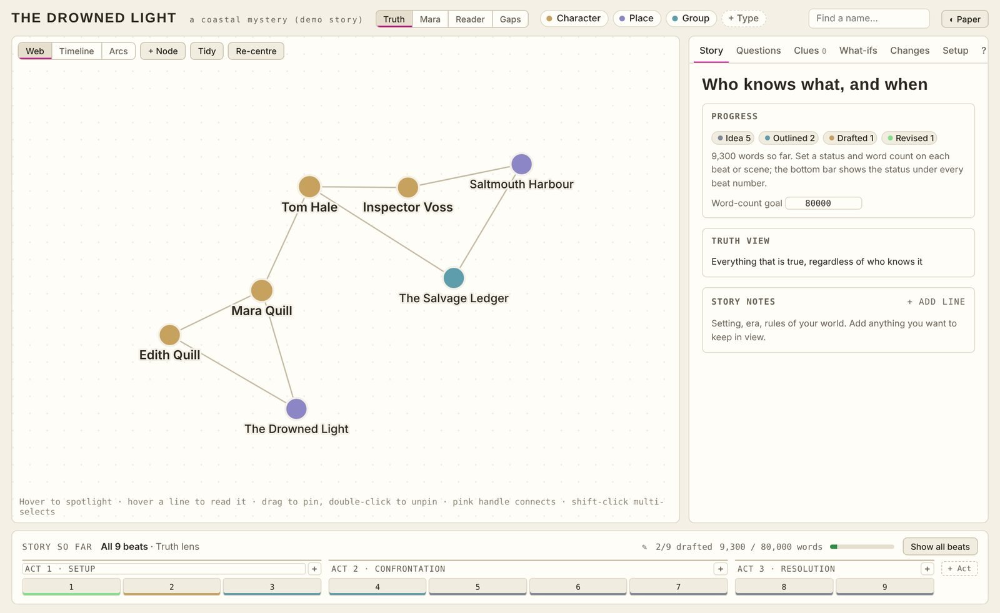
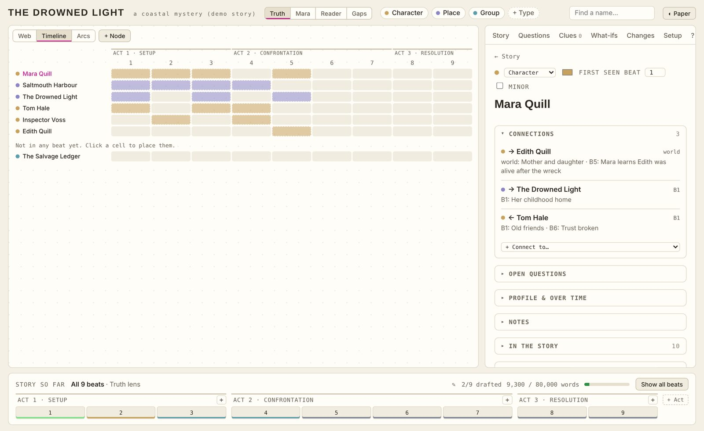
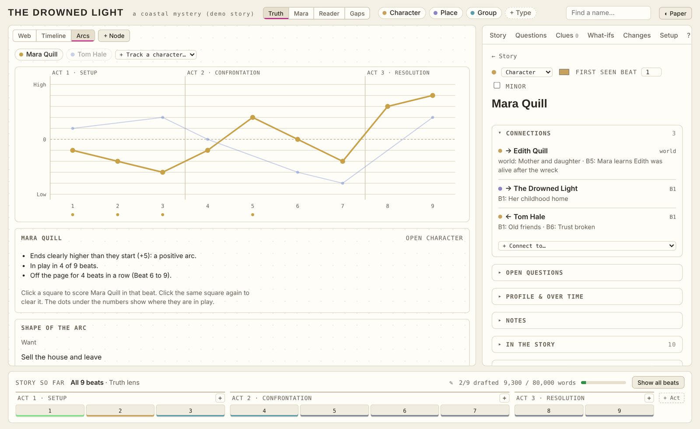
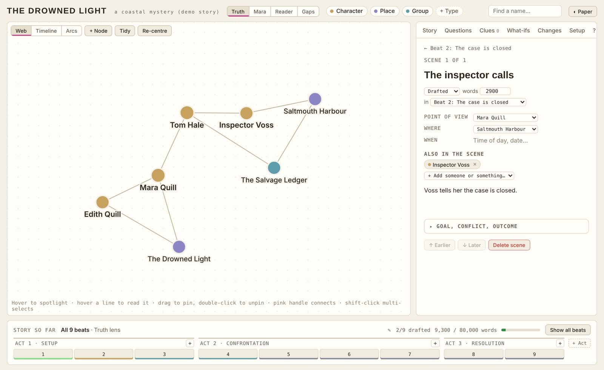
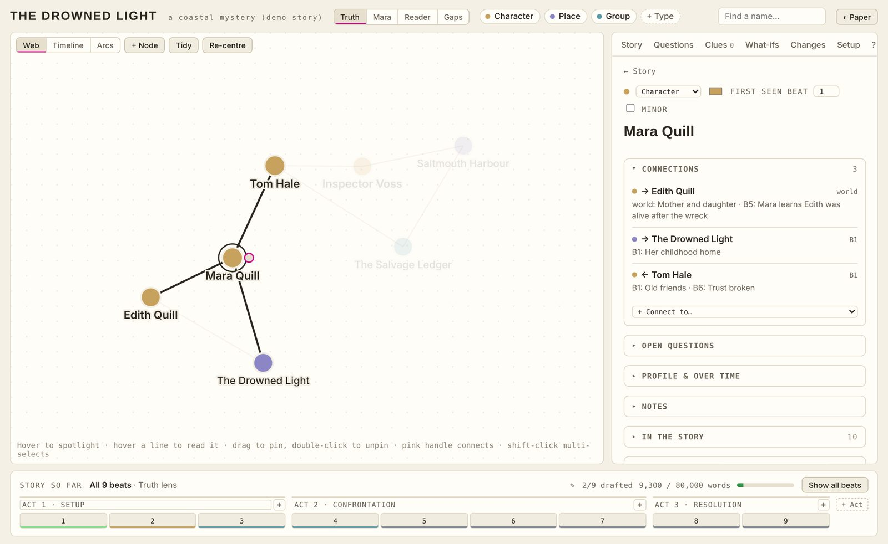
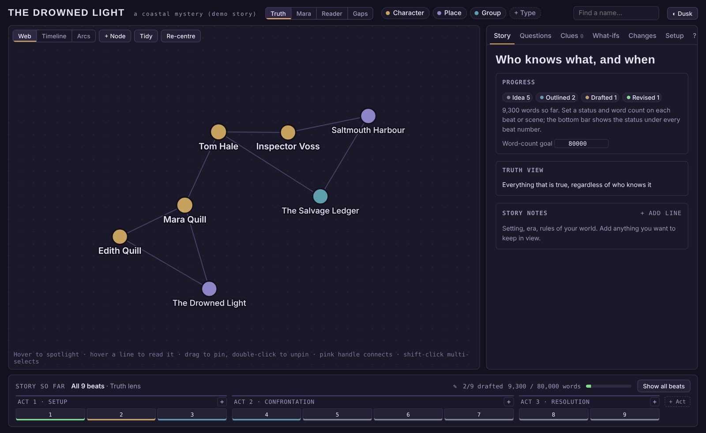

<h1 align="center">Story Webber</h1>

<b>A free, private planner for novel writers.</b> 
Map your characters, places and secrets. Plan every chapter and scene. Chart how your characters change.

<a href="https://YOURNAME.github.io/story-webber/"><b>▶ Open Story Webber</b></a>
&nbsp;·&nbsp; No sign-up &nbsp;·&nbsp; Free &nbsp;·&nbsp; Your story never leaves your device

---

## Why you might like it

Most planning tools are lists. Stories aren't. They're **webs**: who knows whom, who knows what, and when the reader finds out.

Story Webber puts all of that on one board, then lets you zoom from the whole book down to a single scene.

<table>
<tr>
<td width="50%"> <b>Timeline</b> See at a glance who is in play in every chapter, and who has gone missing for too long.</td>
<td width="50%"> <b>Character arcs</b> Score each character chapter by chapter. It spots flat arcs and long absences for you.</td>
</tr>
<tr>
<td width="50%"> <b>Chapters and scenes</b> Point of view, location, cast and status for every scene. Chapter progress adds itself up.</td>
<td width="50%"> <b>Everything about a character, in one place</b> Connections, what they know and when, their want and need, and every scene they're in.</td>
</tr>
</table>

## What's inside

- **The web:** characters, places, groups, objects or ideas, joined by connections. Make your own types and colours.
- **Who knows what:** switch between the truth, your viewpoint character and the reader to find plot holes and moments of dramatic irony.
- **Chapters and scenes:** call them chapters, episodes, beats or anything else. Drag to reorder. Numbers and links update everywhere.
- **Story structures:** start from Three-act, Save the Cat, Hero's Journey or Seven-point, or build your own.
- **Draft tracking:** status and word counts, with a progress bar towards your goal.
- **What-ifs:** try an alternative plot without touching the real one, then make it canon or throw it away.
- **Clues and open questions:** plant something in chapter 3, pay it off in chapter 20, and don't lose track of the decisions you haven't made yet.
- **Undo:** every change is logged and can be undone.
- **Works on phones**, with three looks to suit how you like to write:

 

## Getting started

1. Open the link above.
2. Pick a story structure, or add your own acts and chapters in the bar at the bottom.
3. Press **+ Node** and add your first character.
4. Follow the little checklist on the Story tab. It takes a couple of minutes.

Everything can be renamed right where you see it. There's no setup form to fill in first.

## Your story stays yours

Everything is saved **in your own browser, on your own device**. There's no account and nothing is uploaded.

- Use **Setup → Download backup** now and then to keep a copy.
- Use **Load a backup** to move your story to another device.
- Clearing your browser data erases the story, so keep a backup.

## Run it yourself

It's a single file. Download `index.html` and open it in any browser. No install, no build step.

## Licence

MIT. Free to use, copy and change. See [LICENSE](LICENSE).
